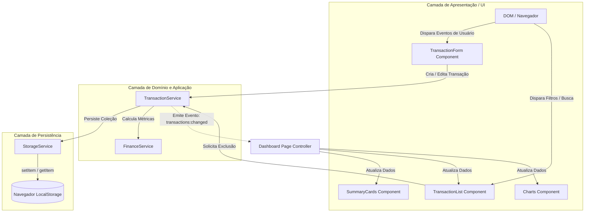

# Arquitetura de Software — Track Balance

Este documento detalha o padrão arquitetural, a divisão de responsabilidades, o fluxo de dados unidirecional e as fronteiras do projeto **Track Balance**.

---

## 1. Visão Geral da Arquitetura

O **Track Balance** adota uma arquitetura em camadas orientada a eventos e fluxo unidirecional de dados, inspirada no padrão **Model-View-Service** adaptado para Vanilla JavaScript com **ES Modules**.

---

## 2. Divisão de Responsabilidades (Separation of Concerns)

### 2.1. Camada de Apresentação (`src/js/components/` & `src/js/pages/`)
- **`dashboard.js`**: Ponto de orquestração. Inicializa a tela, escuta as mudanças nos dados e coordena a re-renderização dos componentes dependentes.
- **`summary-cards.js`**: Componente puro responsável por renderizar os 4 cards principais: Saldo Atual, Receitas, Despesas e Balanço % do período.
- **`transaction-list.js`**: Renderiza a tabela de transações, filtros, paginação e estados vazios. Sanitiza dados antes da injeção.
- **`transaction-form.js`**: Controla o modal, gerencia o ciclo de vida do formulário (criação e edição) e valida os inputs em tempo real.
- **`charts.js`**: Encapsula a biblioteca Chart.js, destruindo e recriando instâncias de gráficos para prevenir vazamentos de memória (memory leaks).

### 2.2. Camada de Serviços e Domínio (`src/js/services/` & `src/js/models/`)
- **`transaction.js` (Model)**: Fábrica de transações. Garante integridade do esquema (UUID, data ISO, tipo e valor absoluto).
- **`transaction-service.js`**: Mantém o estado em memória (Single Source of Truth), aplica filtros (mês, categoria, tipo, busca) e orquestra a persistência.
- **`finance-service.js`**: Funções puras de cálculo financeiro (somas de receitas, despesas, balanço, agrupamento por categoria para gráficos). Isento de qualquer manipulação de DOM.
- **`storage-service.js`**: Camada que encapsula o acesso ao `localStorage`, provendo fallback seguro para JSON inválido e detecção de cota excedida.

### 2.3. Camada de Utilitários (`src/js/utils/`)
- **`currency.js`**: Formatação para o padrão BRL (`R$ 1.250,00`) e conversão de strings monetárias.
- **`dates.js`**: Formatação de datas em formato legível brasileiro e extração de mês/ano para filtros.
- **`validators.js`**: Validação de regras (ex: valor maior que zero, descrição não vazia).

---

## 3. Fluxo Unidirecional de Dados

Para evitar estados inconsistentes (ex: o saldo exibir R$ 500 enquanto a tabela soma R$ 600), nenhuma visualização calcula suas próprias métricas:

1. **Ação:** O usuário preenche o formulário e clica em "Salvar".
2. **Validação:** O formulário chama `validateTransaction(formData)`.
3. **Despacho:** Se válido, chama `transactionService.add(data)`.
4. **Persistência:** `transactionService` armazena no `localStorage` via `storageService.save(transactions)`.
5. **Notificação:** `transactionService` notifica o orquestrador emitindo o evento de mudança.
6. **Cálculo:** `financeService.calculateSummary(filteredTransactions)` gera o consolidado.
7. **Re-renderização:** `summaryCards.render()`, `transactionList.render()` e `charts.update()` recebem os novos dados e atualizam a interface simultaneamente.

---

## 4. Por que essa arquitetura impressiona?

1. **Testabilidade:** As regras matemáticas de finanças em `finance-service.js` são funções puras e podem ser testadas via `node:test` sem precisar de navegador ou JSDOM.
2. **Manutenibilidade:** O estilo da interface ou a biblioteca de gráficos podem ser alterados sem tocar em nenhuma linha das regras de cálculo financeiro.
3. **Escalabilidade:** Se no futuro for adicionada uma API REST ou IndexedDB, apenas `storage-service.js` precisará ser atualizado.
